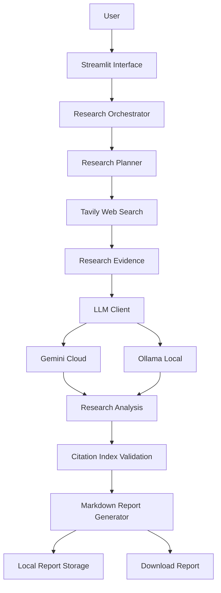

# Agentic_AI
 
"15 AI-AGENTS READY To PLAY IN YOUR AI PLAYGROUND!"


# 🔬 AI Research Assistant

An AI-powered research assistant that automates topic-based research using web search, hybrid Large Language Model (LLM) providers, and structured report generation.

Built with Python and Streamlit, this project combines Tavily web search with Google Gemini and locally hosted Ollama models to collect research evidence, analyze findings, and generate downloadable Markdown research reports.

> **15 Days | 15 AI Agents — Agent 01**

---

## 📌 Project Overview

Researching a technical topic often requires visiting multiple websites, collecting information, comparing findings, and organizing everything into a structured report.

The AI Research Assistant simplifies this workflow.

Users provide a research topic, select an AI provider, and let the application:

1. Generate relevant research questions.
2. Search the web using Tavily.
3. Collect and organize relevant research sources.
4. Analyze the collected evidence using an LLM.
5. Generate a structured research report.
6. Save the report locally and provide a Markdown download.

The application supports both cloud-based and locally hosted LLM providers.

---

## ✨ Key Features

- **Automated Research Planning:** Generates research questions and expected report sections from a given topic.
- **Web Search Integration:** Uses the Tavily Search API to retrieve relevant online sources.
- **Hybrid LLM Architecture:** Supports Google Gemini (cloud) and Ollama (local).
- **Evidence-Based Analysis:** Provides collected source content to the selected LLM for research analysis.
- **Source References:** Includes numbered source references in the analysis and original source URLs in the report.
- **Citation Index Validation:** Checks whether cited source numbers fall within the available source range.
- **Markdown Report Generation:** Creates structured research reports.
- **Local Report Storage:** Saves generated reports in the `outputs/reports/` directory.
- **Download Support:** Allows users to download their research reports directly from Streamlit.
- **Automated Testing:** Includes pytest tests for planning, orchestration, evidence handling, citation validation, and report generation.

---

## 🏗️ System Architecture

The application follows a modular architecture that separates the user interface, research orchestration, external tools, LLM integration, and report generation.



### Component Responsibilities

| Component | Responsibility |
|---|---|
| `app.py` | Streamlit user interface |
| `agent.py` | Orchestrates the complete research workflow |
| `planner.py` | Generates research questions and report sections |
| `tools.py` | Integrates Tavily web search and collects evidence |
| `llm_client.py` | Handles Gemini and Ollama model requests |
| `report_generator.py` | Generates and saves Markdown reports |

---

## 🛠️ Technology Stack

| Technology | Purpose |
|---|---|
| Python | Core programming language |
| Streamlit | Interactive web interface |
| Google Gemini API | Cloud-based LLM analysis |
| Ollama | Local LLM execution |
| Tavily API | Web search and information retrieval |
| Pydantic | Structured research-plan validation |
| Requests | HTTP communication |
| python-dotenv | Environment variable management |
| pytest | Automated testing |

---

## 📂 Project Structure

```text
Day-01-Research-Assistant/
│
├── app.py
├── agent.py
├── planner.py
├── tools.py
├── llm_client.py
├── report_generator.py
├── config.py
│
├── tests/
│   ├── test_agent.py
│   ├── test_planner.py
│   └── test_report_generator.py
│
├── outputs/
│   └── reports/
│
├── screenshots/
│
├── test_llm.py
├── test_tools.py
├── test_planner.py
│
├── .env
├── .env.example
├── .gitignore
├── pytest.ini
├── requirements.txt
└── README.md
```

---

## ⚙️ Installation and Setup

Follow these steps to run the project locally.

### 1. Clone the repository

```bash
git clone https://github.com/YOUR_USERNAME/Day-01-Research-Assistant.git
```

Navigate into the project directory:

```bash
cd Day-01-Research-Assistant
```

### 2. Create a virtual environment

```bash
python -m venv venv
```

Activate it on Windows PowerShell:

```powershell
.\venv\Scripts\Activate.ps1
```

### 3. Install dependencies

```bash
pip install -r requirements.txt
```

### 4. Configure API credentials

Create a `.env` file in the project root.

Add the following configuration:

```env
GEMINI_API_KEY=your_gemini_api_key
GEMINI_MODEL=your_supported_gemini_model

TAVILY_API_KEY=your_tavily_api_key

OLLAMA_MODEL=llama3.2:3b
```

**Get your API credentials:**

- Google Gemini: https://aistudio.google.com/apikey
- Tavily: https://app.tavily.com/

Never upload your actual `.env` file or API keys to GitHub.

### 5. Configure Ollama (Local LLM)

Download and install Ollama:

https://ollama.com/download

Pull the model:

```bash
ollama pull llama3.2:3b
```

Run the model:

```bash
ollama run llama3.2:3b
```

The application can use Ollama as its local LLM provider.

### 6. Launch the application

```bash
streamlit run app.py
```

Open the local Streamlit URL displayed in your terminal, usually:

```text
http://localhost:8501
```

---

## 🚀 How to Use

1. Launch the application.
2. Select your preferred LLM provider:
   - `gemini` — Cloud-based analysis.
   - `ollama` — Local model execution.
3. Enter a research topic.
4. Click **Start Research**.
5. Review the generated research plan.
6. Explore the collected web sources.
7. Read the AI-generated research analysis.
8. Download the final Markdown report.

### Example Research Topics

- RAG vs Fine-tuning in LLM Applications
- Applications of Generative AI in Healthcare
- AI Agents and Autonomous Systems
- Large Language Models and Their Limitations
- Retrieval-Augmented Generation Architecture

---

## 🧪 Automated Testing

The project uses pytest for automated testing.

Run all tests:

```bash
python -m pytest -v
```

### Test Coverage

| Test Module | Test Cases |
|---|---:|
| `test_agent.py` | 4 |
| `test_planner.py` | 3 |
| `test_report_generator.py` | 2 |
| **Total** | **9** |

### Latest Test Results

```text
============================= test session starts =============================

collected 9 items

tests/test_agent.py ................ PASSED
tests/test_planner.py ............... PASSED
tests/test_report_generator.py ...... PASSED

============================= 9 passed ==============================
```

**Verified:** 9 out of 9 automated tests passed.

The automated tests use mocked dependencies for the research workflow. Live Gemini and Tavily integrations were also manually verified through the Streamlit application.

---

## 📄 Generated Reports

Research reports are automatically saved in:

```text
outputs/reports/
```

Each report contains:

- Research topic
- Generation timestamp
- Research analysis
- Numbered source list
- Original source URLs

Reports are generated in Markdown format and can be downloaded directly through the application.

---

## 🔐 Security Considerations

- API credentials are stored in environment variables.
- `.env` is excluded from version control.
- Local model execution is supported through Ollama.
- Retrieved webpage content is treated as untrusted input in the analysis prompt.
- Source references are checked for valid source-number ranges.

---

## ⚠️ Current Limitations

This is the first version of the AI Research Assistant. Some capabilities can be improved in future iterations.

- Research questions are currently generated using predefined templates rather than an LLM-based planning process.
- Research quality depends on the relevance and quality of retrieved web sources.
- Citation index validation checks source-number ranges, not whether each cited source semantically supports the associated claim.
- The application does not yet implement persistent conversational memory.
- Large-scale concurrent usage and production deployment have not yet been benchmarked.
- Ollama performance depends on the available local hardware and selected model.

---

## 🔮 Future Improvements

Potential enhancements include:

- Dynamic LLM-powered research planning.
- Improved source ranking and relevance filtering.
- Semantic citation verification.
- Research history and persistent memory.
- PDF and DOCX report export.
- Advanced multi-step research workflows.
- Improved observability and performance monitoring.
- Production deployment and scalability improvements.

---

## 👨‍💻 Author

**Rajarshi Yadav**

Software Engineer | AI/ML Enthusiast

This project is part of my personal engineering challenge:

**15 Days — 15 AI Agents**

The objective is to design, implement, test, and publish practical AI agent projects while strengthening my understanding of AI engineering, LLM integration, tool usage, and software architecture.

---

## ⭐ Support

If you find this project useful or interesting, consider giving the repository a ⭐ on GitHub.

Feedback and suggestions are welcome!


## 🖥️ Application Screenshots

### Research Interface


### Collected Research Sources


### Generated Research Report


### Testing Questions : RAG vs Fine-tuning in LLM applications

## Agent 01:
- A research planning module.
- Parallel web-search capabilities using Tavily.
- Hybrid LLM integration with Ollama and Gemini.
- Evidence collection and citation validation.
- Automated Markdown report generation.
- Performance monitoring and automated testing.
- A redesigned, professional Streamlit interface.